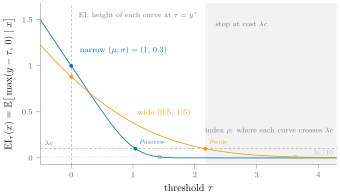

You have 100 GPU-hours to tune a model and a configuration that already performs reasonably well. Your shortlist contains a learning-rate adjustment that takes one GPU-hour to evaluate and a larger model that takes twenty. Either could improve the validation score. Either could disappoint.

Which should you run first? And if the first result is excellent, should you run the other at all? The budget tells you how much you can spend. It does not tell you whether the next experiment is worth its cost.

To answer that, we need a trade-off the GPU-hour budget leaves unspecified. How much improvement would justify another hour of training? Suppose you would pay up to ten GPU-hours for one percentage point of validation accuracy. Then an hour costs the equivalent of 0.1 percentage points. This exchange rate is a choice about what better predictions are worth to you; it cannot be inferred from the budget alone.

We can now judge a completed search by the accuracy of the best model it found, minus the cost of all the runs it took to find it. Failed experiments still count toward the bill.

## From training runs to Pandora’s boxes

Fix the training data, validation set, and random seed for each configuration. Each run now has a definite score that we learn when training finishes. Beforehand, we express our uncertainty through probabilities: a configuration might have a high chance of a modest improvement and a small chance of a large one.

Imagine each configuration as a closed box containing its score. Opening the box costs the compute needed to train it. We retain the best score revealed so far, including the model we started with.

After each opening, we can stop or pay to open another box. A complete plan specifies that choice for every result we might encounter. Such a plan is called a *policy*.

Different outcomes can make the same policy stop with different models and different bills. We judge it by its *expected net value*: average the final best score minus the converted cost of all opened boxes, weighting each possible outcome by its probability.

We will begin by assuming the scores in different boxes are independent: revealing one does not change the probabilities we assign to the others. This still leaves room for a result to change our next decision. An excellent score makes another experiment less attractive because we already have something better, even though our beliefs about that experiment have not changed.

This is a substantial simplification for hyperparameter tuning. Nearby configurations often perform similarly. We will restore that dependence later; first, we want to understand the choices that remain even when each experiment tells us only its own score.

This independent search problem is called *Pandora’s box*. [Weitzman (1979)](https://scholar.harvard.edu/files/weitzman/files/optimalsearchbestalternative.pdf) derived its optimal reservation-value rule. We will work toward that rule from the training decision above.

## The score that makes a run break even

Suppose only the twenty-GPU-hour run remains. The current model scores 80%, and we give the untested model equal chances of scoring 79% or 85%. If we run it, half the time we keep our current model and gain nothing; half the time we gain five percentage points. The expected gain is therefore 2.5 points. The run costs the equivalent of two points, leaving an expected net gain of half a point.

If we already had an 84% model, the same experiment would offer only half a point of expected gain. We would stop. Somewhere between 80% and 84% lies the score at which opening this box just pays for itself.

That score is 81%. If we already have an 81% model, the disappointing outcome adds nothing, while the successful outcome adds four percentage points. With equal chances, the expected gain is two points, exactly the cost of the run.

We call 81% this configuration’s *reservation value*, denoted $\rho(x)$. It is the score we would need in hand to be indifferent between evaluating configuration $x$ and stopping. Below it, this last experiment is worth running; above it, we prefer to keep what we have. The reservation value belongs to the unopened box: it depends on its possible scores and evaluation cost, rather than on our current best score.

Write $y$ for the unknown score inside box $x$, and $\tau$ for a score we might already have. Opening the box improves that score by $\max(y-\tau,0)$. Its average over the possible outcomes is the *expected improvement*:

$$
\mathrm{EI}_{\tau}(x)
\triangleq\mathbb{E}[\max(y-\tau,0)\mid x].
$$

Let $c(x)$ be the training cost in GPU-hours and $\lambda$ its conversion into accuracy points. The reservation value is the threshold at which expected improvement equals converted cost:

$$
\mathrm{EI}_{\rho(x)}(x)=\lambda c(x).
$$

Our calculation was exactly this equation: at $\rho(x)=81$, the expected improvement is two points, matching $\lambda c(x)=0.1\times20=2$.

## Which run should come first?

Suppose the one-hour learning-rate adjustment has equal chances of scoring 80% or 82%. Its converted cost is 0.1 accuracy points. With an 81.8% model in hand, its expected improvement is half of 0.2 points, exactly its cost. Its reservation value is therefore 81.8%, higher than the larger model’s 81%.

At our current score of 80%, however, the larger model offers more expected improvement: 2.5 points versus one. Ranking by expected improvement favors the larger model; ranking by reservation value favors the cheap adjustment. We can now compare what happens when we actually follow those two orders.

Run the learning-rate adjustment first. Half the time it scores 82%. We then stop: the larger model offers only 1.5 points of expected improvement against its two-point cost. Our final score minus expenditure is $82-0.1=81.9$.

The other half of the time, the adjustment scores 80%. The larger model is still worth trying. It leaves us with an expected best score of 82.5%, and the two runs together cost 2.1 accuracy points, giving an expected net value of 80.4. Averaging the two branches, the cheap-first policy is worth $(81.9+80.4)/2=81.15$.


The successful first run avoids the expensive evaluation. On the continuation branch, $(77.9+82.9)/2=80.4$.


Reverse the order. Half the time the larger model scores 85%, and we stop with a net value of $85-2=83$. Otherwise it scores 79%, so we retain our original 80% model and try the adjustment. That leaves an expected best score of 81%, minus 2.1 points of total cost, for a net value of 78.9.

The larger-first policy is therefore worth $(83+78.9)/2=80.95$, compared with 81.15 for cheap-first. Starting with the larger reservation value wins here. A successful cheap run saves twenty GPU-hours; a successful expensive run saves only one.


If the larger model scores 79%, we retain the original 80% model. The continuation branch is worth $(77.9+79.9)/2=78.9$.


Both policies fit within our hundred-hour budget, even when they run both experiments. Their difference comes from whether the extra accuracy earns its cost.

This example also has a limitation. Subtracting cost from the next run’s expected improvement gives 0.9 points for the adjustment and 0.5 for the larger model. That one-step calculation also favors the adjustment. The example explains how ordering and stopping affect the outcome; it does not yet establish why reservation values solve the full search problem.

## Pandora’s rule and the Gittins index

Compute the reservation value of every unopened box. Open the one with the largest value, provided that value exceeds the best score already available. After observing its score, make the same comparison again. Stop when the score in hand is at least as large as every remaining reservation value.

Independence makes this procedure especially simple: the reservation values of unopened boxes do not change after an observation. We can sort them once. The results determine how far down that ordering we go.

This is **Pandora’s rule**, and $\rho(x)$ is its reservation index. Under independent, integrable scores, a finite shortlist, and positive evaluation costs, it maximizes expected final score minus total converted cost over all adaptive policies.

The name *Gittins index* places this rule within a wider family of index solutions to sequential allocation problems. Here, each index is calibrated against a sure alternative: the score that would make us stop. The classical discounted-reward bandit has a different objective, accumulating rewards over repeated plays. This post uses the Pandora version, where we pay to reveal scores and keep only the best. [Xie, Astudillo, Frazier, Scully, and Terenin (NeurIPS 2024)](https://arxiv.org/abs/2406.20062) develop its use in BO as the *Pandora’s Box Gittins Index* (PBGI).

The proof works by capping each score at its reservation value. For configuration $n$ with score $y_n$, reservation value $\rho_n$, and evaluation cost $c_n$, write

$$
\begin{aligned}
z_n&\triangleq\min(y_n,\rho_n),\\
d_n&\triangleq\max(y_n-\rho_n,0).
\end{aligned}
$$

The original score is $y_n=z_n+d_n$. The break-even equation says $\mathbb E[d_n]=\lambda c_n$: the expected amount removed by capping equals the cost of opening that box.

For the larger model, capping at 81 turns its possible scores 79 and 85 into 79 and 81. For the adjustment, the capped scores are 80 and 81.8. Let $Z$ be the best of all the capped scores and the original 80% model. Independence lets us bound *any* policy's expected net value by $\mathbb E[Z]$. In this example,


$$
\mathbb E[Z]=\tfrac12(81.8)+\tfrac14(81)+\tfrac14(80)=81.15.
$$
<!-- narrow -->
$$
\begin{aligned}
\mathbb E[Z]&=\tfrac12(81.8)+\tfrac14(81)\\
&\quad+\tfrac14(80)\\
&=81.15.
\end{aligned}
$$


The cheap-first policy attains this bound. In general, the reservation ordering ensures that an opened box with positive removed excess becomes the winner and ends the search. No discarded opened box has positive excess, and stopping leaves no better capped score unopened. Those two properties make the bound tight. The [full proof](#appendix-a-why-the-index-policy-is-optimal) follows the capped-value argument of [Kleinberg, Waggoner, and Weyl (2016)](https://arxiv.org/abs/1603.07682).

## The same index as a minimizer

Assuming a finite second moment, the reservation value has another useful representation:


$$
\rho(x)=\arg\min_{\tau}\left\{\mathbb E\!\left[\tfrac12\max(y-\tau,0)^2\mid x\right]+\lambda c(x)\tau\right\}.
$$
<!-- narrow -->
$$
\begin{aligned}
L_x(\tau)&\triangleq\mathbb E\!\left[\tfrac12\max(y-\tau,0)^2\mid x\right]\\
&\quad+\lambda c(x)\tau,\\[6pt]
\rho(x)&=\arg\min_{\tau}L_x(\tau).
\end{aligned}
$$


Here $L_x(\tau)$ denotes the complete objective being minimized. Its derivative is

$$
L_x'(\tau)
=\lambda c(x)-\mathrm{EI}_{\tau}(x).
$$

Expected improvement decreases as the threshold rises. Thus $L_x'(\tau)$ increases, crossing zero precisely where expected improvement equals cost. Minimizing $L_x$ recovers the same break-even threshold; it provides a way to compute the index without changing the policy we just proved optimal.

This is the maximization form of the linear-quadratic reservation-value loss in [Atsidakou et al., *Contextual Pandora’s Box* (2022)](https://arxiv.org/abs/2205.13114), up to a term independent of the threshold. Learning the index from this loss belongs in a follow-up; here it gives an equivalent characterization.

## EI and explicit lookahead

Suppose we simplify the search by allowing at most one more evaluation. Write $y^*$ for the best score currently available. Evaluating $x$, then stopping, has expected net gain

$$
\mathrm{EI}_{y^*}(x)-\lambda c(x).
$$

We choose the configuration with the largest positive gain, or stop if none is positive. When evaluation costs are equal, their subtraction does not affect the ranking: the rule becomes ordinary expected improvement. With unequal costs, this derivation subtracts $\lambda c(x)$; it does not divide EI by cost.

This is a one-step lookahead approximation. It removes every decision after the next evaluation. The reservation-index policy solves the full independent-box search, including the option to continue after a disappointing result.

Let $R$ be the remaining configurations. With one evaluation left, the best expected net gain is


$$
V_1(y^*,R)\triangleq\max\!\left\{0,\max_{x\in R}[\mathrm{EI}_{y^*}(x)-\lambda c(x)]\right\}.
$$
<!-- narrow -->
$$
\begin{aligned}
Q_1(x)&\triangleq\mathrm{EI}_{y^*}(x)-\lambda c(x),\\[6pt]
V_1(y^*,R)&\triangleq\max\{0,\max_{x\in R}Q_1(x)\}.
\end{aligned}
$$


The zero represents stopping. With two evaluations available, evaluating $x$ also leaves a second decision after its score $y$ is revealed. Write $y^{*\prime}\triangleq\max(y^*,y)$ for the new best score and $R'\triangleq R\setminus\{x\}$ for the remaining configurations:


$$
Q_2(x)\triangleq-\lambda c(x)+\mathbb E\big[\max(y-y^*,0)+V_1(y^{*\prime},R')\mid x\big].
$$
<!-- narrow -->
$$
\begin{aligned}
Q_2(x)&\triangleq-\lambda c(x)\\
&\quad+\mathbb E\big[\max(y-y^*,0)\\
&\qquad+V_1(y^{*\prime},R')\mid x\big].
\end{aligned}
$$


The first term inside the expectation is the immediate improvement. The second is the value of the best remaining decision, including stopping. Crucially, we choose that second action *after* seeing $y$. This is how lookahead extends the planning horizon.

We choose the first action by maximizing $Q_2(x)$, unless stopping is better:

$$
V_2(y^*,R)=\max\{0,\max_{x\in R}Q_2(x)\}.
$$

With no configurations remaining, the continuation value is zero. Allowing three evaluations replaces the $V_1$ inside the expectation by $V_2$; further steps repeat the construction. This recursive calculation is called *dynamic programming*: solve the remaining decisions to determine the value of the current one.

For independent boxes, the reservation-index policy attains the value of planning through all remaining evaluations. We need not enumerate those future branches to choose the next box. The index compresses that calculation; it does not shorten its horizon.

## What changes when configurations are correlated?

Return to the learning-rate adjustment. Suppose another unopened configuration uses a nearby learning rate. A disappointing result from the first may lower our expectations for the second; a strong result may raise them. A different model family might be less affected.

The continuation value now depends on more than the best score $y^*$ and the remaining set $R$. It also depends on the observations collected so far, which we denote by $\mathcal D$. After evaluating $x$, we update to

$$
\mathcal D'=\mathcal D\cup\{(x,y)\}.
$$

Planning the second evaluation must use beliefs conditioned on $\mathcal D'$. The first experiment can now improve our model *and* change which other experiments look promising. [Jiang et al. (2020)](https://arxiv.org/abs/2006.15779) develop multi-step trees for planning with these posterior updates.

We can still compute a reservation value from each configuration’s current distribution:

$$
\mathbb E[\max(y-\rho_{\mathcal D}(x),0)\mid x,\mathcal D]=\lambda c(x).
$$

If the largest index exceeds the incumbent, evaluate that configuration, observe the result, update the model, and recompute; otherwise stop. Correlations affect these updates: a result at one learning rate can change the indices at nearby learning rates.

This is the posterior-updated PBGI construction of [Xie et al.](https://arxiv.org/abs/2406.20062). The approximation occurs when choosing the next evaluation. We use the rule that would be optimal if the current candidate distributions were independent. It does not anticipate how a future observation will change beliefs about other candidates. Those changes enter only after we observe the result and update again.

Multi-step EI explicitly plans future evaluations: for each possible next result, it considers what to evaluate afterward, and repeats this calculation to a chosen depth. Its approximation is the lookahead cutoff.

The reservation-index policy is also *non-myopic*: it accounts for the option to keep searching after disappointing results and stop after good ones. Under independence, the index theorem solves that entire future-planning problem. The simple ranking rule is the result of solving it, not of ignoring the future.

The initial model also assumed exact scores and completed evaluations. Noisy measurements, repeated training seeds, and early termination require richer observation and action models; the independent-box theorem does not cover them as stated.

## A UCB-shaped bonus from evaluation cost

As evaluation becomes cheaper, we are willing to investigate smaller chances of beating an already strong model. The break-even threshold therefore rises:

$$
\lambda c(x)\downarrow
\quad\Longrightarrow\quad
\rho(x)\uparrow.
$$

Under Gaussian beliefs, sufficiently small costs push that threshold above the predicted mean $\mu(x)$, into the upper tail. Write $\sigma(x)\gt0$ for the posterior standard deviation, measuring uncertainty about the configuration’s fixed score. We can express the reservation value as

$$
\rho(x)=\mu(x)+a(x)\sigma(x),
$$

where $a(x)$ is the number of standard deviations above the mean. To connect the index to UCB, we need to determine how this bonus depends on cost.

For one configuration, suppress $x$ and write its Gaussian score as $y=\mu+\sigma W$, where $W$ is standard normal. At the reservation threshold $\rho=\mu+a\sigma$,

$$
\max(y-\rho,0)=\sigma\max(W-a,0).
$$

The break-even equation becomes

$$
\mathbb E[\max(W-a,0)]
=\frac{\lambda c}{\sigma}.
$$

Writing $\varphi$ and $\Phi$ for the standard normal density and cumulative distribution function, the expectation is


$$
\int_a^\infty(w-a)\varphi(w)\,dw=\varphi(a)-a[1-\Phi(a)].
$$
<!-- narrow -->
$$
\begin{aligned}
&\int_a^\infty(w-a)\varphi(w)\,dw\\
&\qquad=\varphi(a)-a[1-\Phi(a)].
\end{aligned}
$$


This determines the bonus $a$: the expected improvement beyond it must equal the evaluation cost measured in units of posterior uncertainty.

Write $\varepsilon\triangleq\lambda c/\sigma$. As evaluation becomes cheap relative to uncertainty, $\varepsilon\to0$ and the break-even bonus $a\to\infty$. The expected excess in this tail behaves like $\varphi(a)/a^2$. Balancing its dominant exponential decay against cost gives

$$
a\sim\sqrt{2\log\frac{\sigma}{\lambda c}}.
$$

The [tail calculation](#appendix-b-the-gaussian-small-cost-limit) shows where the square root of a logarithm comes from. This UCB connection is also established in [Xie et al., Appendix B.3](https://arxiv.org/html/2406.20062v3).

For two configurations with the same predicted mean and uncertainty, the cheaper one has the higher reservation index. Its smaller cost justifies pursuing a more remote chance of improvement. Under Gaussian beliefs, the small-cost approximation makes that tradeoff explicit:

$$
\rho(x)-\mu(x)\approx\sigma(x)\sqrt{2\log\frac{\sigma(x)}{\lambda c(x)}}.
$$

Lowering the price $\lambda$ raises the exploration bonus. Raising the cost $c(x)$ lowers it. The bonus now reflects how much we are willing to spend investigating an uncertain configuration.

Writing the approximation in UCB form,

$$
\begin{aligned}
\rho(x)&\approx\mu(x)+\sqrt{\beta(x)}\,\sigma(x),\\
\beta(x)&\triangleq2\log\frac{\sigma(x)}{\lambda c(x)},
\end{aligned}
$$

reveals an exploration coefficient determined by cost and uncertainty. Even with equal evaluation costs, this coefficient varies across configurations because their uncertainties differ. We have recovered the UCB *form* in the small-cost limit. A confidence guarantee or regret bound would require a separate argument.

The square-root expression explains the shape of the exploration bonus; we do not need it to compute the index. For any positive cost, we can solve

$$
\varphi(a)-a[1-\Phi(a)]
=\frac{\lambda c}{\sigma}
$$

numerically and set $\rho=\mu+a\sigma$. This also covers expensive evaluations, where the reservation value can fall below the mean. The index policy still compares that value with the incumbent to decide whether to evaluate or stop.

The following Gaussian example separates the two rankings even with equal costs. It uses generic score units and an incumbent $y^*=0$, rather than the accuracy scale of our training example.

At $\tau=y^*=0$, the narrow candidate offers more expected improvement. At the common cost $\lambda c=0.1$, the wide candidate has the larger index. Reducing that cost to 0.01 moves both crossings to the right. The shaded stopping region applies to the 0.1 cost line only. [Open the full-size plot](ei-threshold.svg).

Validation accuracy is bounded above, whereas Gaussian beliefs allow arbitrarily large scores. For a bounded score distribution, cheap evaluation pushes the reservation value toward its upper endpoint. The break-even rule still applies; the diverging Gaussian bonus depends on the Gaussian tail assumption.

## What happened to the budget?

We began with 100 GPU-hours. The theorem optimizes expected final score minus expenditure. Let $M$ be the final best score, $I_n$ indicate whether configuration $n$ was evaluated, and $c_n$ be its cost. The objective is

$$
\mathbb E\!\left[M-\lambda\sum_n I_n c_n\right].
$$

A strict budget requires, on every possible sequence of outcomes,

$$
\sum_n I_n c_n\leq100
.
$$

The price $\lambda$ makes spending less attractive, but does not enforce that constraint. With a hard cap, a run also consumes resources that could make another run affordable later. The independent-box optimality proof does not establish that ranking affordable configurations by their reservation indices solves this budget-constrained problem.

Suppose we instead require spending to stay below $B$ *on average*. Writing $C\triangleq\sum_n I_n c_n$, the constraint is $\mathbb E[C]\leq B$. Assigning a price $\lambda\geq0$ to excess spending gives


$$
\mathbb E[M]-\lambda(\mathbb E[C]-B)=\mathbb E[M-\lambda C]+\lambda B.
$$
<!-- narrow -->
$$
\begin{aligned}
&\mathbb E[M]-\lambda(\mathbb E[C]-B)\\
&\qquad=\mathbb E[M-\lambda C]+\lambda B.
\end{aligned}
$$


For fixed $\lambda$, the last term does not depend on our decisions. Optimizing this expression therefore recovers our cost-penalized search problem. This connects the price to an expected resource allowance, although choosing a price that achieves that allowance is a separate problem.

## Choosing the next run

The same expected-improvement function plays three roles. With one evaluation left, we evaluate it at the incumbent $y^*$ and compare the gain with cost. For independent candidates with further evaluations available, we solve

$$
\mathrm{EI}_{\rho(x)}(x)=\lambda c(x)
$$

and rank the resulting reservation values; the theorem accounts for subsequent decisions to continue or stop. Under Gaussian beliefs and small costs, those reservation values take a UCB-shaped form. These connections explain which planning assumptions and approximations lead to each rule.

When choosing the next training run, we should ask what decisions its result will make possible. A disappointing result may justify another experiment; a strong result may let us stop. Multi-step EI represents these possibilities explicitly through lookahead. Under independence, the reservation-index theorem compresses the full sequence of contingent decisions into one number per configuration. That is why a simple acquisition rule can embody a nonmyopic policy.

## Appendix A: Why the index policy is optimal

Number the configurations $x_1,\ldots,x_N$. Write $y_n$ for the score in box $n$, $\rho_n=\rho(x_n)$ for its reservation value, and $c_n=c(x_n)$ for its evaluation cost. Split each score into a *capped score* $z_n$ and a *removed excess* $d_n$:

$$
\begin{aligned}
z_n &\triangleq \min(y_n,\rho_n),\\
d_n &\triangleq \max(y_n-\rho_n,0),\\
y_n &= z_n+d_n.
\end{aligned}
$$

For the larger model, capping at 81 turns the possible scores 79 and 85 into 79 and 81. The removed excess is zero or four, each with probability one half. Its expectation is two points, exactly the converted evaluation cost. More generally, the reservation-value equation gives

$$
\mathbb{E}[d_n]=\lambda c_n.
$$

This is an equality of expectations; the realized excess $d_n$ need not equal the fixed cost $\lambda c_n$.

Now let $I_n$ be the *opening indicator*: it equals one if a policy opens box $n$ and zero otherwise. The decision to open that box uses earlier results, before $y_n$ is revealed. Since the boxes are independent, $I_n$ is independent of $y_n$ and hence of $d_n$. Therefore

$$
\begin{aligned}
\mathbb{E}[I_n d_n]
&=\mathbb{E}[I_n]\mathbb{E}[d_n]\\
&=\lambda c_n\mathbb{E}[I_n]\\
&=\mathbb{E}[I_n\lambda c_n].
\end{aligned}
$$

Summing over boxes shows that the policy’s expected total cost equals its expected total removed excess. Independence is essential to this step: with dependent scores, the boxes we choose to open can have different expected excesses after earlier results are observed.

Let $y_0$ be the original model’s score and $S=\{n:I_n=1\}$ the set of opened boxes. The final best score is

$$
M\triangleq \max\bigl(\{y_0\}\cup\{y_n:n\in S\}\bigr).
$$

For comparison, define the best capped score using *all* boxes, whether opened or not:

$$
Z\triangleq\max\bigl(\{y_0\}\cup\{z_n:1\leq n\leq N\}\bigr).
$$

For every realization of the scores,

$$
M-\sum_{n=1}^{N}I_n d_n\leq Z.
$$

If an opened box $n_\star$ supplies the winning score, then $M=y_{n_\star}=z_{n_\star}+d_{n_\star}$, so

$$
\begin{aligned}
M-\sum_{n=1}^{N}I_n d_n
&=z_{n_\star}-\sum_{\substack{n\in S\\n\ne n_\star}}d_n\\
&\leq z_{n_\star}\leq Z.
\end{aligned}
$$

If the original model wins, subtracting nonnegative excesses gives a value at most $y_0\leq Z$. Taking expectations and using the indicator identity above yields


$$
\begin{aligned}
\mathbb E\!\left[M-\lambda\sum_n I_n c_n\right]
&=\mathbb E\!\left[M-\sum_n I_n d_n\right]\\
&\leq\mathbb E[Z].
\end{aligned}
$$
<!-- narrow -->
$$
\begin{aligned}
&\mathbb E\!\left[M-\lambda\sum_n I_n c_n\right]\\
&\qquad=\mathbb E\!\left[M-\sum_n I_n d_n\right]\\
&\qquad\leq\mathbb E[Z].
\end{aligned}
$$


Every policy’s expected net value is bounded by the expected best capped score. Including $y_0$ makes the bound apply even when the policy opens no boxes.

Suppose an opened box $n$ exceeds its reservation value, so $d_n\gt0$. The policy opened it only because the previous best score was below $\rho_n$. Since $y_n\gt\rho_n$, this box becomes the winner. Every remaining reservation value is at most $\rho_n$, so the policy stops immediately.

Consequently, only the winning box can have positive removed excess. All other opened boxes have $d_n=0$. The subtraction in our bound therefore removes excess from the winner alone, rather than also charging for excesses in discarded boxes.

For the adjustment, $z_1$ is 80 or 81.8; for the larger model, $z_2$ is 79 or 81. With independent, equally likely outcomes,


$$
\mathbb E[Z]=\tfrac12(81.8)+\tfrac14(81)+\tfrac14(80)=81.15.
$$
<!-- narrow -->
$$
\begin{aligned}
\mathbb E[Z]&=\tfrac12(81.8)+\tfrac14(81)\\
&\quad+\tfrac14(80)\\
&=81.15.
\end{aligned}
$$


This is exactly the cheap-first policy’s expected net value. The bound proves that no other policy can do better in our example, including policies we did not explicitly enumerate.

The equality extends beyond our example. If the policy stops after opening a box $n_\star$ with positive excess, its capped score is $\rho_{n_\star}$. Every earlier score is below $\rho_{n_\star}$, while every unopened box satisfies

$$
z_n\leq\rho_n\leq\rho_{n_\star}.
$$

Thus $Z=\rho_{n_\star}$, and

$$
M-\sum_{n=1}^{N}I_nd_n=y_{n_\star}-d_{n_\star}=Z.
$$

If no opened box has positive excess, all opened scores equal their capped scores. At stopping, every unopened capped score is at most the best score in hand, so $M=Z$. Again the equality holds.

Taking expectations,

$$
\mathbb E\!\left[M-\lambda\sum_{n=1}^{N}I_nc_n\right]=\mathbb E[Z].
$$

The index policy attains the bound on every policy’s expected net value. This establishes its optimality for independent boxes with evaluation costs and the option to stop.

## Appendix B: The Gaussian small-cost limit

For one Gaussian candidate, recall $a=(\rho-\mu)/\sigma$ and the break-even equation $\varphi(a)-a[1-\Phi(a)]=\lambda c/\sigma$.

Write $\varepsilon\triangleq\lambda c/\sigma$. Cheap evaluation means $\varepsilon\to0$, which pushes the break-even bonus $a\to\infty$. In that tail,


$$
1-\Phi(a)=\varphi(a)\left(a^{-1}-a^{-3}+O(a^{-5})\right).
$$
<!-- narrow -->
$$
\begin{aligned}
1-\Phi(a)&=\varphi(a)\bigl(a^{-1}-a^{-3}\\
&\qquad\qquad+O(a^{-5})\bigr).
\end{aligned}
$$


Substituting into the expected improvement cancels the leading terms:

$$
\varepsilon
=\frac{\varphi(a)}{a^2}\left(1+O(a^{-2})\right).
$$

Since $\varphi(a)=e^{-a^2/2}/\sqrt{2\pi}$, taking logarithms gives


$$
\log\frac1\varepsilon=\frac{a^2}{2}+2\log a+\frac12\log(2\pi)+o(1).
$$
<!-- narrow -->
$$
\begin{aligned}
\log\frac1\varepsilon&=\frac{a^2}{2}+2\log a\\
&\quad+\frac12\log(2\pi)+o(1).
\end{aligned}
$$


The quadratic term dominates, so to leading order

$$
a\sim\sqrt{2\log\frac{\sigma}{\lambda c}}.
$$

The familiar square root of a logarithm comes from balancing a Gaussian tail against the price of an evaluation.
