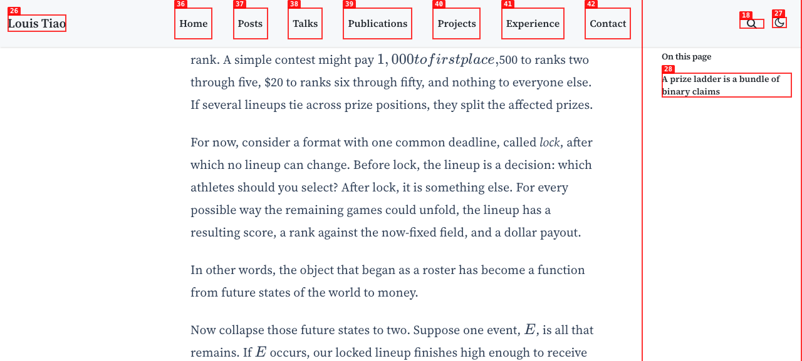
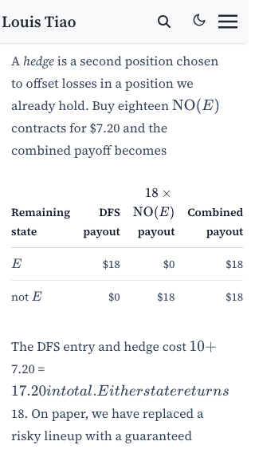
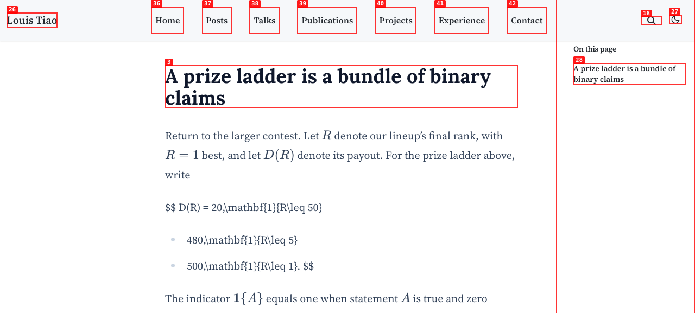
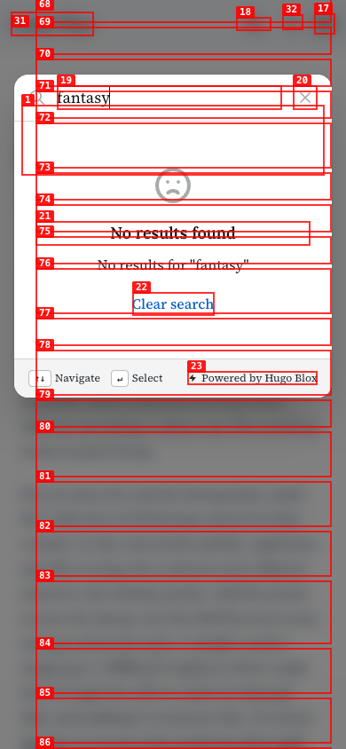
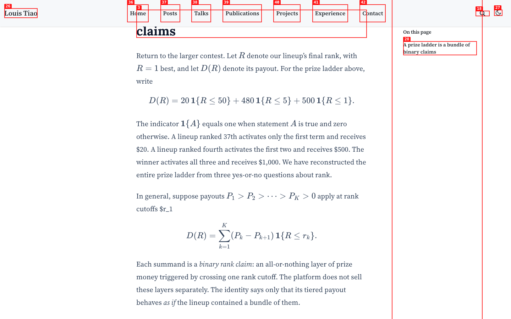
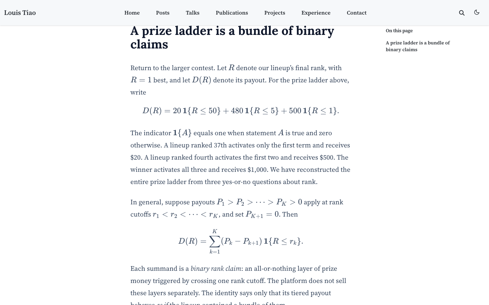

# Dogfood Report: DFS as a Portfolio draft

| Field | Value |
|-------|-------|
| **Date** | 2026-08-30 |
| **App URL** | http://127.0.0.1:1313/posts/dfs-as-a-portfolio/ |
| **Session** | 127-0-0-1 |
| **Scope** | Current draft post: desktop and mobile rendering, mathematical notation, payoff table, links, browser errors, and accessibility |

## Summary

| Status | Count |
|--------|-------|
| Resolved | 3 |
| Expected development limitation | 1 |
| Open | 0 |
| **Total documented issues** | **4** |

Final production-preview audit: three rendered display equations; page and
per-equation widths contained at 1440px, 390px, and 320px; zero axe WCAG A/AA
violations. Axe left one color-contrast check incomplete for manual review.
Pagefind initialized successfully; the only console warning was the expected
missing giscus discussion for this draft.

## Issues

### ISSUE-001: Currency amounts consume surrounding prose as mathematics

| Field | Value |
|-------|-------|
| **Severity** | medium |
| **Category** | visual / content / accessibility |
| **URL** | http://127.0.0.1:1313/posts/dfs-as-a-portfolio/ |
| **Repro Video** | N/A (static issue) |

**Status:** resolved (fresh production-preview evidence, 2026-08-30).

Currency uses isolated `&#36;` prose/table tokens. At 1440×900,
390px, and 320px the rendered text remains accessible prose and the document
scroll width equals the viewport (1440, 390, and 320 respectively). The final
DOM audit found 22 currency tokens and no surrounding prose inside KaTeX.

Fresh production-preview evidence:
[desktop](screenshots/fresh-production-1440.png),
[390px](screenshots/fresh-production-390.png), and
[320px](screenshots/fresh-production-320.png).

**Description**

Currency amounts in prose are interpreted as opening and closing math delimiters. Text between successive amounts is rendered as concatenated italic mathematical identifiers, removing spaces and punctuation. For example, “\$1,000 to first place, \$500” appears visually as “1,000tofirstplace,500.” The accessibility tree likewise exposes the intervening words as individual MathML identifiers instead of prose. At a 320-pixel viewport, these unbreakable KaTeX spans increase the document scroll width to 519 pixels. This affects several paragraphs, materially impairs readability and screen-reader output, and introduces horizontal page overflow on narrow screens.

**Repro Steps**

1. Navigate to the draft URL and scroll to the first paragraph containing the example prize schedule.
2. Reload the page and return to the same paragraph.
3. **Observe:** the words between the first two currency amounts are rendered as mathematics without normal spacing.

   

   

---

### ISSUE-002: Prize decomposition renders as literal TeX and a bullet list

| Field | Value |
|-------|-------|
| **Severity** | medium |
| **Category** | visual / content / accessibility |
| **URL** | http://127.0.0.1:1313/posts/dfs-as-a-portfolio/ |
| **Repro Video** | N/A (static issue) |

**Status:** resolved (fresh production-preview evidence, 2026-08-30).

The decomposition is now one aligned KaTeX display split across three rows.
The final DOM check found three rendered displays, no decomposition list items,
and equal client/scroll widths for every display at 1440px, 390px, and 320px.
Axe reported zero WCAG A/AA violations at all three widths.

Fresh production-preview evidence:
[desktop](screenshots/resolved-equation-production-1440.png),
[390px](screenshots/resolved-math-production-390.png), and
[320px](screenshots/resolved-math-production-320.png).

**Description**

The first multiline display equation under “A prize ladder is a bundle of binary claims” does not render as mathematics. Its opening and closing `$$` delimiters remain visible, TeX commands such as `\mathbf` and `\leq` appear literally, and the two continuation lines beginning with `+` become Markdown bullet items. The accessibility tree confirms that this is a paragraph followed by a list rather than one mathematical expression. This breaks the article’s central decomposition.

**Repro Steps**

1. Navigate to the draft URL and scroll to “A prize ladder is a bundle of binary claims.”
2. Reload the page and return to the section.
3. **Observe:** the three-term decomposition appears as literal TeX split across a paragraph and two bullets.

   

---

### ISSUE-003: Search is nonfunctional in the Hugo development preview

| Field | Value |
|-------|-------|
| **Severity** | low |
| **Category** | functional / console |
| **URL** | http://127.0.0.1:1313/posts/dfs-as-a-portfolio/ |
| **Repro Video** | videos/issue-003-repro.webm |

**Status:** expected development limitation (not a product bug).

**Description**

The search overlay behavior remains specific to the plain Hugo development
preview: it does not run the production Pagefind step, so
`http://127.0.0.1:1313/pagefind/pagefind.js` is expected to be absent there.
The production static preview indexed 98 pages and the browser console reported
`✓ Pagefind initialized` at all three viewports.

**Repro Steps**

1. Open the draft at mobile width.

   

2. Select the search control in the header.

   

3. Type `fantasy` into the search field.
4. **Observe:** the overlay reports that no results were found, while the console records a missing Pagefind module and a null search client.

   

---

### ISSUE-004: Literal less-than signs truncate inline rank notation

| Field | Value |
|-------|-------|
| **Severity** | medium |
| **Category** | visual / content / accessibility |
| **URL** | http://127.0.0.1:1313/posts/dfs-as-a-portfolio/ |
| **Repro Video** | N/A (static issue) |

**Status:** resolved (fresh production-preview evidence, 2026-08-30).

The rank-cutoff chain now uses TeX `\lt` commands. The browser exposes one
complete inline expression, including all four cutoffs and three less-than
operators, with no raw delimiter in visible prose.

**Description**

The source used literal `<` characters inside
`$r_1<r_2<\cdots<r_K$`. HTML parsing claimed the first `<r_2...` fragment
before KaTeX could render it, leaving the visible prose truncated at the raw
text `$r_1` and omitting the remainder of the cutoff chain.

**Repro Steps**

1. Open the article and scroll below the prize-ladder decomposition.
2. **Observe:** the sentence ends visibly at raw `$r_1`, immediately before
   the general display equation.

   

3. Replace the literal operators with `\lt`, rebuild with drafts, and reload.
4. **Observe:** the complete chain renders as one inline expression.

   

---
